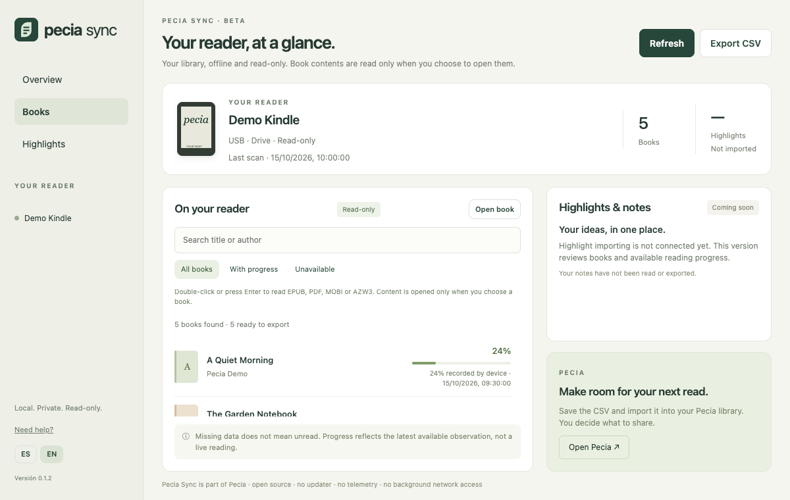
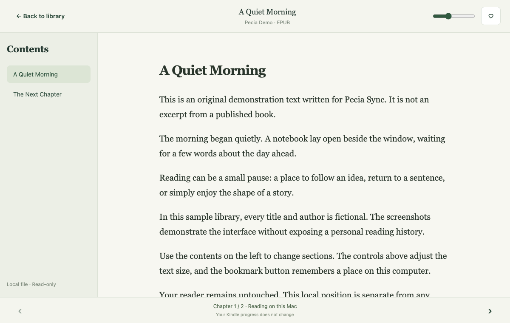

# Pecia Sync

An open-source, offline, read-only Kindle and Kobo library importer for
[Pecia](https://pecia.app).

## Beta status

Pecia Sync is currently `0.1.2` and intended for testing. Kindle MTP and
Kindle USB Drive Mode have been tested on macOS. Kobo support has automated
coverage against a sanitized SQLite fixture but still needs a physical-device
test; it is not yet a compatibility promise. See the
[compatibility matrix](docs/compatibility.md).

Sync writes a Goodreads-shaped CSV with optional `Pecia Sync …` columns for
progress, last-read date, source, device ID and opt-in highlights. It uses an
explicit local review step: Kindle reads visible object names, while Kobo reads
only its local library metadata database in read-only mode. Scanning never reads
ebook contents. Opening a book is a separate, explicit action.

## Offline reader (development)

See the [reader guide](docs/reader-guide.md) for opening books, navigation,
bookmarks, resume behaviour and troubleshooting.





Screenshots capture the real webview interface in a browser at 1200 × 760.
Device responses and book contents are synthetic; they are not hardware-support
evidence. Native macOS window decorations are not included.

Double-click a supported book (or focus it and press Enter), or use **Open book**
to select a local file. EPUB, PDF, DRM-free MOBI and AZW3 are supported by bundled
parsers: no Calibre installation or network conversion is required. Direct
device opening currently supports mounted Kindle USB drives; MTP and Kobo users
can select a local copy. KFX and AZW are not supported.

The reader provides section/page navigation, text sizing or PDF zoom, a local
bookmark and resume position. Positions are keyed by a content hash and stored
in local webview storage, separately from device progress and CSV exports.
No book content is persisted by the reader. Original files are never modified.

MOBI/AZW3 parsing uses pinned MIT-licensed
[Foliate-js](https://github.com/johnfactotum/foliate-js); its license ships in
public/licenses/foliate-js.txt. Its full HTML renderer is not used: extracted
text and embedded raster images pass through our inert allowlist renderer.
Book scripts, styles, external URLs, media and embedded fonts are not loaded.
Encryption is rejected, including encrypted headers in hybrid MOBI/KF8 files.
This is a simplified reflowable reader, not exact Kindle typesetting.

Limits: 32 MB input, 80 MB expanded content, 16 MB per section. Password-protected
PDFs and EPUBs with encryption declarations are currently unsupported.
Regression tests use synthetic content. Read-only parser checks succeeded for
one physical-device MOBI (29 sections) and one AZW3; no private book fixtures
are committed. Broader firmware/book compatibility is not yet guaranteed.

### Kindle progress observations

On mounted Kindle USB drives, review also reads
`system/fmcache/fmcache.db` with SQLite's read-only flag. The latest valid
`shared_reading_update_v2` percentage is matched to a visible book by its exact
filename content-ID suffix. Only the percentage and observation time are
returned alongside that book. Missing, inaccessible or incompatible caches
leave progress unavailable; they never imply unread.

These are temporary observations, not a complete or live reading history.
The device-reported value may differ from the on-screen percentage; Sync does
not adjust it. The review displays the observation time, and CSV exports carry
it in `Pecia Sync Progress Observed At`, separately from `Pecia Sync Last Read`.
The 2016 Kindle was inspected read-only; MTP progress extraction is not yet
implemented or validated on the 2024 Kindle. Progress scanning opens no ebook contents.

## Local Goodreads review

Before saving a CSV, Sync makes a small number of safe, local presentation
fixes that can improve matching in Goodreads, such as moving a trailing article
to the front of a title or separating an accidentally joined author name. The
review summary keeps this compact: it shows how many records are ready, which
ones were adjusted, and which need attention.

Sync never looks up books online, invents an ISBN, or guesses an author or
edition. Records with incomplete metadata, such as a missing author, are put in
an editable review queue. Any edits apply only to the CSV the reader explicitly
chooses to save; the e-reader is never changed. ISBNs remain the most reliable
way for Goodreads to match a particular edition.

## Non-negotiable boundary

- No sign-in, background network requests, telemetry, runtime updater, or
  downloader.
- No Amazon, Kobo or Adobe credentials.
- Book contents are read only after an explicit open action. No DRM licence is
  read, no protection is removed, and no content is uploaded or modified.
- Device discovery and metadata review happen only after the reader clicks the
  corresponding local action. Hardware serials are never returned to the UI.
- Nothing is installed or written to a connected e-reader.
- CSV output is saved only after the reader chooses its destination in the
  native save panel. Reader positions and bookmarks are stored locally.
- The app keeps no persistent logs. Its optional support email includes only
  the app version, OS/architecture, and a short in-memory record of safe
  operation counts—never book titles, files, databases, accounts or device IDs.

The source and Tauri capability manifest are public so these claims can be
audited.

## Development

```sh
npm install
npm test
npm run build
npm run tauri dev
cargo test --manifest-path src-tauri/Cargo.toml
```

CI verifies the project on macOS, Ubuntu and Windows and builds distributable
desktop packages. Tagged releases include checksums for every installer.

## Help, security and contributing

For reader support or compatibility reports, email
[hola@pecia.app](mailto:hola@pecia.app). Do not attach ebooks, Kindle/Kobo
databases, account information, or device serial numbers.

See [CONTRIBUTING.md](CONTRIBUTING.md) for development and test expectations,
and [SECURITY.md](SECURITY.md) for responsible disclosure. Release history is
kept in [CHANGELOG.md](CHANGELOG.md).
